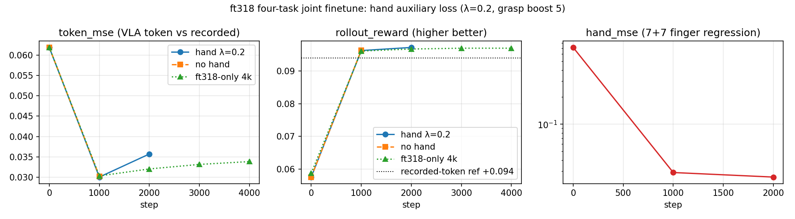
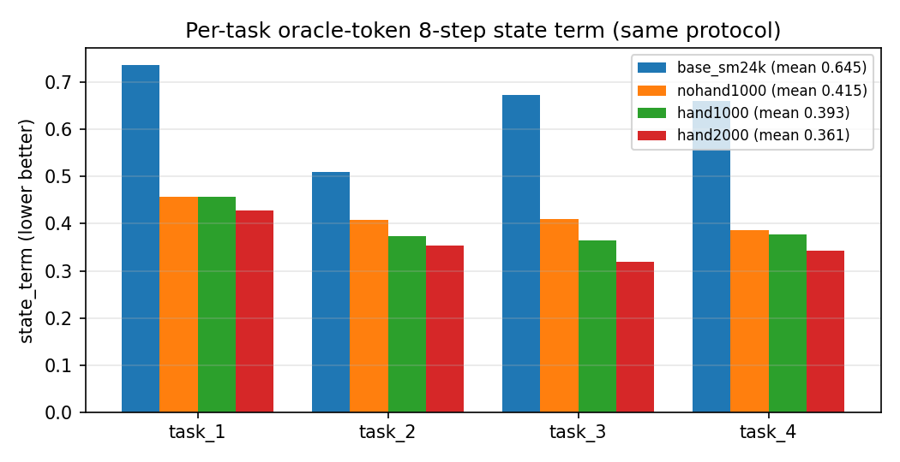

# ft318 四任务 · 带手部辅助监督的联合微调：1000 步效果核对（2026-10-25）

> **一句话**：1000 步那份 ckpt 确实存在（`runs/joint_sm24k_hand/joint_001000.pt`），而且那次 run 实际跑到
> **2000 步** 才停（计划 12000）。1000 步时身体指标已经到了平台（`token_mse` −51%、`state_term` −94%、
> `rollout_reward` +67%），手部误差 −96%；和**同一配方但不开手部项**的 run 逐项在噪声内一致
> ⇒ 手部辅助项不损伤身体，白赚 14 维手指回归。四任务逐个都变好。**但这个 run 没有存 `vla_*.pt`**，
> 所以既不能合成部署 ckpt，也没有闭环视频 —— 本页所有数字都是训练侧/想象 rollout 口径。

## 1. 事实核对（用户问的"是不是 1000 步"）

| 项 | 事实 | 证据 |
|---|---|---|
| run 目录 | `runs/joint_sm24k_hand/` | — |
| 数据 | `data/npz/g1_tasks` = **ft318 318 clips / 473,876 帧 / 2.633 h / 4 任务** | `train.log` `MotionLibrary(full): 318 clips, 473876 frames` |
| 底模 | SuperMimic `e9_bones_seed_token_h200x2/ckpt_0024000.pt`（run 名里的 `sm24k`） | 本次比对：该底模与 `joint_001000.pt` 的 `wm` **逐位相同（max\|Δ\| = 0）** |
| 手部项 | `--hand-loss-weight 0.2 --hand-grasp-boost 5`（抓取帧 5 倍权重） | `train.log`: `[hand] 辅助监督开启: λ=0.2 boost=5.0` |
| 1000 步 ckpt | `joint_001000.pt`（75.8 MB，10-24 04:39:51） | `ls` |
| 实际跑到 | **2000 步**（`joint_002000.pt`，05:21:57）；日志止于 `[step 1900/12000]`、无任何报错，紧接着写 `eval 2000` 再存盘 ⇒ **被外部停止**（不是训练崩溃） | `train.log` / `eval_curve.jsonl` 时间戳 |
| 计划步数 | 12000 | 日志 `[step 1000/12000]` |
| VLA 权重 | **没有** `vla_*.pt` | 该 run 没开 `--save-vla-every`；`ls runs/joint_sm24k_hand/` 只有 `joint_00{1000,2000}.pt` |

⇒ 用户记的"1000 步"是对的（1000 步 ckpt 存在、也到过 1000 步评测点）；只是那次 run 又往前走了 1000 步。

## 2. 训练侧曲线（同一批 eval 帧，H=8，混合 4 任务）



| run | step | `token_mse` | `state_term` | `rollout_reward` | `hand_mse` |
|---|---|---|---|---|---|
| **joint_sm24k_hand（λ=0.2）** | 0 | 0.061862 | 3.029704 | +0.057582 | 0.711540 |
|  | **1000** | **0.030050** | **0.173060** | **+0.096274** | **0.029061** |
|  | 2000 | 0.035716 | 0.089364 | +0.097227 | 0.025874 |
| joint_diff_sm24k（同底模，**无手部项**） | 0 | 0.061862 | 3.029704 | +0.057582 | — |
|  | 1000 | 0.030254 | 0.179098 | +0.096367 | — |
| joint_diff_ft318（无手，另一条 VLA/token 线） | 1000 | 0.030337 | 0.183354 | +0.096131 | — |
|  | 4000 | 0.033851 | 0.105645 | +0.096995 | — |

读数（都按"越小越好/越大越好"）：

* **1000 步就把活干完了**：`token_mse` 0.0619→0.0300（−51%），`state_term` 3.03→0.173（−94%），
  `rollout_reward` +0.0576→+0.0963（+67%，**已经越过录制 token 参照 +0.094**）。
* **手部项是白赚的**：`hand_mse` 0.712→0.0291（−96%）；同底模无手版在 1000 步的
  `0.0303 / 0.179 / 0.0964` 与它差不到 1% —— 加手部监督没有从身体项里偷容量。
* **2000 步是"reward 平台 + token 漂移"**：reward 再涨 +0.001，`state_term` 到 0.089，
  但 `token_mse` 反弹到 0.0357（和 ft318-only 那条线 2000 步 0.0320 同一现象，
  即文档里记过的漂移；接 `--token-anchor-weight` 才压得住）。

## 3. 四任务逐任务（统一口径：**录制 token + 冻结 WM 的 8 步想象 rollout**）

口径说明：`scripts/eval_joint_tasks_ft318.py`，每个任务从自己的 89/70/65/94 条 clip 里
固定采样（seed 12345，batch 4 × 2 组），条件用 npz 里录制的 `g1_motion_token_64`（= oracle token，
不跑 GR00T），用训练同一个 `imagine_with_tokens` + `compute_joint_loss` 算 `state_term` / `rollout_reward`。
四个 ckpt 完全同协议，所以**横向可比**；绝对值不要和 §2 的 `eval_curve` 混用（采样帧不同）。



| ckpt | task_1<br>milk_basket | task_2<br>red_cup_drawer | task_3<br>plate_milk | task_4<br>can_low_chair | mean `state_term` | mean `rollout_reward` |
|---|---|---|---|---|---|---|
| 底模 sm24k（= step 0） | 0.7364 | 0.5090 | 0.6732 | 0.6606 | 0.6448 | +0.0898 |
| 无手 @1000 | 0.4571 | 0.4076 | 0.4092 | 0.3866 | 0.4151 | +0.0925 |
| **带手 @1000** | **0.4570** | **0.3729** | **0.3637** | **0.3775** | **0.3928** | **+0.0925** |
| 带手 @2000 | 0.4276 | 0.3543 | 0.3188 | 0.3436 | 0.3611 | +0.0925 |

* 四个任务**全部**下降，task_1（meeting_room_milk_basket）最难、掉得最少；
* 带手 vs 无手在同一 1000 步：0.393 vs 0.415（−5%），和 §2 的方向一致（带手略好）；
* 拆开看 `state_term = pos + ori + q + vel`：四个 ckpt 的 pos/ori/q 基本一样
  （pos 3.0–4.9e-4、ori 0.0034–0.0041、q 0.0038–0.0058），**差异几乎全在 `state_vel`**
  （0.635 底模 → 0.406 无手@1000 → 0.384 带手@1000 → 0.353 @2000）——
  和 `docs/TOKEN_ANCHOR.md` 里"速度通道是 WM 弱项、占了 state 项 96% 能量"的结论完全对得上。
  换句话说：**位置/关节跟踪在 1000 步前后本来就都很好，这次提升主要来自速度通道。**

## 4. 做不了 / 不能当结论的事（如实记录）

1. **没有闭环视频**：`runs/joint_sm24k_hand` 里没有 `vla_*.pt`，`export_vla_ckpt.py` 没有输入，
   所以做不出可部署 ckpt，`closed_loop/code/mosaic_n17/tools/closed_loop_mujoco.py` 跑不了这个 run。
   `runs/closed_loop/*.mp4`（task1..4 四任务）是 **VLA 20k / ft4000 那条线**的，不是这个 run。
2. **仓库自带的真实 MuJoCo 回路这次判不了优劣**：`scripts/eval_mujoco.py` 的环境连
   **teacher 基线**（直接把参考关节目标喂进去）都在 ~0.45 s 触发终止（`joint_rmse` 0.27、
   全程 `survival` 0.08）——该 env 没有平衡控制器、参考又是动态 clip，谁上去都倒。
   为此新增了 `scripts/eval_joint_token_mujoco.py`（token 条件版，能跑通 recorded token），
   但 env 本身的限制没变，**不拿来下结论**。
3. **不是 hold-out**：eval 批次与训练同库采样（`docs/JOINT_DIFF_FT318.md` §7 第 11 条），
   衡量的是"拟合与改善趋势"，不是泛化。
4. **数据政策**：ft318 已按 `docs/DATA_POLICY_HA_ONLY.md` **永久禁用**（入口硬拒）。
   本页只是对历史 run 的结果核对，不构成重启 ft318 的依据。

## 5. 闭环推理视频（真实 MuJoCo 物理，task1 clip）

用户要求"拿 2000 的跑一下仿真闭环推理、出视频"。做法（`scripts/closed_loop_joint_token.py`）：

* 仿真：部署场景 `SONIC_DATA/.../g1/scene_43dof.xml` + `groot_repro/g1_sim.py` 的按名关节映射
  （与 `runs/closed_loop/*.mp4` 同一套 MuJoCo 栈），**500 Hz PD 在每个物理子步重算**，
  力矩上限 88 Nm，物理步长 2 ms；
* 条件：ft318 npz 里**录制**的 64 维 token，每 20 ms 一个（= oracle token 闭环，不跑 GR00T）；
* 手：录制 `g1_hand_joints_14` 直接打目标；
* 出生点按最低接触点抬高 3.7 cm（参考 z 是脚触地 FK 估的，原样出生等于往地板里插 3.7 cm）。

| ckpt | 时长 | 倒没倒 | 平均关节误差 | 末帧误差 | 最大倾角 | 最大 \|yaw\| | 底座最大漂移 |
|---|---|---|---|---|---|---|---|
| 底模 sm24k（= step 0） | 12 s | 站住 | 0.172 rad | 0.199 | 14.5° | 43.4° | 0.34 m |
| **带手 @2000** | 12 s | 站住 | 0.179 rad | 0.192 | 15.7° | 40.8° | 0.18 m |

视频：`runs/closed_loop_joint/task1_hand2000.mp4`（2000 步）、`runs/closed_loop_joint/task1_base.mp4`（底模对照），
左边世界侧视、右边头戴相机。

**怎么读**：

* 两个 ckpt 都能在真实物理里站满 12 s、手臂跟踪像样（关节误差 ~10°，主要是手臂/手腕），
  2000 步没有肉眼可见的优势 —— 内部评测里 `state_term 0.645→0.36` 的提升，
  **没有**在这个 sim 的"平均关节误差"上再现（0.179 vs 0.172，末帧 0.192 vs 0.199 反而略好）。
  真实物理里的主要偏差是**底座 yaw 漂移**（40°+/12 s），2000 步的 xy 漂移减半（0.18 vs 0.34 m），
  但单条 clip 不足以下结论。
* 一条重要前提：这是 **oracle token** 闭环（条件用录制 token）。这个 run 没有 `vla_*.pt`，
  所以"VLA 出 token → WBC"的部署闭环跑不了；要那个得看 HA 线（`runs/joint_ha_a1` 存了 `vla_*.pt`）。
* task1 自己的场景 `scene_43dof_two_table.xml` 里**站不住**：同一个 ckpt 在 ~3 s 倒地
  （`runs/closed_loop_joint/task1_two_table_hand2000.mp4`）。但纯 PD 保持默认姿态在该场景也会倒
  —— 场景本身对这台机器人不友好（出生点/接触），不是这个 ckpt 独有，故视频用无遮挡场景。

## 6. 复现

```bash
COMIMIC=/inspire/hdd/global_user/liumengfan-253108110079/wsc-workspace/comimic
cd $COMIMIC

# 逐任务统一口径（带手 @1000 / @2000、无手 @1000、底模）
for t in hand1000:runs/joint_sm24k_hand/joint_001000.pt \
         hand2000:runs/joint_sm24k_hand/joint_002000.pt \
         nohand1000:runs/joint_diff_sm24k/joint_001000.pt ; do
  tag=${t%%:*}; ck=${t#*:}
  /usr/bin/python3 scripts/eval_joint_tasks_ft318.py --joint-ckpt "$ck" --tag "$tag" --device cuda:0
done
/usr/bin/python3 scripts/eval_joint_tasks_ft318.py \
  --supermimic-ckpt third_party/SuperMimic-Reproduced/logs/e9_bones_seed_token_h200x2/ckpt_0024000.pt \
  --tag base_sm24k --device cuda:0
# 结果：runs/eval_joint_tasks/<tag>.json

# 训练侧曲线的原始记录
cat runs/joint_sm24k_hand/eval_curve.jsonl runs/joint_diff_sm24k/eval_curve.jsonl

# 闭环视频（task1 clip，600 tick = 12 s；底模对照把 --joint-ckpt 换成 --supermimic-ckpt ...）
MUJOCO_GL=egl /usr/bin/python3 scripts/closed_loop_joint_token.py \
  --joint-ckpt runs/joint_sm24k_hand/joint_002000.pt \
  --clip data/npz/g1_tasks/task_1_meeting_room_milk_basket__2026-07-14-19-15-12__ep000000.npz \
  --scene scene_43dof.xml --steps 600 \
  --out-video runs/closed_loop_joint/task1_hand2000.mp4 \
  --out-json  runs/closed_loop_joint/task1_hand2000.json
```

> 渲染前提：容器里 `libegl1`（EGL 分发库）缺失时 MuJoCo 报
> `eglQueryString` / `mjv_updateCamera`；本机 `apt-get install -y --no-install-recommends libegl1`
> 之后 `MUJOCO_GL=egl` 正常出图（已装好）。

新增（本次核对时写的，只读评测，不碰训练）：

| 文件 | 作用 |
|---|---|
| `scripts/eval_joint_tasks_ft318.py` | ft318 四任务逐任务 `state_term`/`rollout_reward`（录制 token 口径） |
| `scripts/eval_joint_token_mujoco.py` | token 条件的真实 MuJoCo 回路（`eval_mujoco.py` 只支持 680 维 goal 路线） |
| `scripts/closed_loop_joint_token.py` | 真实物理闭环 + mp4 录像（500 Hz PD、世界视图+头戴相机） |
| `runs/eval_joint_tasks/*.json` | 上面四个 ckpt 的逐任务结果 |
| `runs/closed_loop_joint/*.mp4`, `*.json` | task1 闭环视频（2000 步 / 底模 / task1 自有场景） |
| `docs/figs/ft318_hand1000_curve.png`、`ft318_hand1000_pertask.png` | 本页两张图 |
