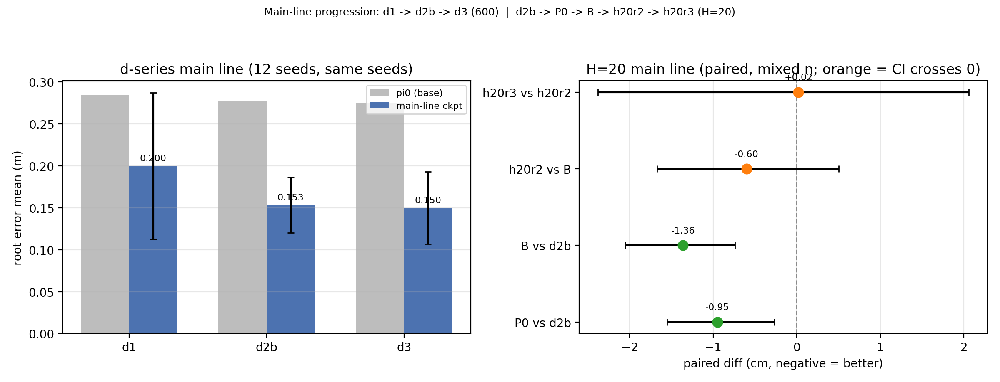

# 主线推进：d1 → d2b → d3 → H=20 → h20r2 → h20r3

> 日期：2026-11-01
> 目的：给一条**主线推进**视图。注意这不是一条严格可比的绝对曲线：
> d 系列是 12 seed vs pi0；H=20 是 32/16 对 vs d2b/B；h20r2/h20r3 是 32 对 vs 上一轮。
> **只比配对差，不跨 run 比绝对均值。**



---

## 1. 主线树（d2 已按你的要求跳过）

```
d1
 └─ d2b
     ├─ d3                    （600-tick 线的最好点）
     └─ P0（H=20, act_w=1.0）
         └─ B（H=20, act_w=0.5）
             └─ h20r2（完整轮）
                 └─ h20r3（act_w=0.25，负结果）
```

> d3 和 P0 都是 d2b 的分支；d3 不是 H=20 的父节点。
> v7/8.5 是执行器 track，不在这条策略主线上，单独列。

---

## 2. d 系列（12 seed，同一批 seed vs pi0）

| 轮 | 候选 root mean | pi0 mean | 配对差 | n |
|---|---|---|---|---|
| d1 | 0.1997 m | 0.2839 m | **−8.42 cm** | 12 |
| d2b | 0.1531 m | 0.2766 m | **−12.35 cm** | 12 |
| d3 | **0.1498 m** | 0.2751 m | **−12.54 cm** | 12 |

- d1 → d2b：**−8.4 → −12.4 cm**，这是最大的一跳；
- d2b → d3：只再降 **0.19 cm**，600 线基本到顶；
- 这组数字是同一批 12 seed，可以放在一起看趋势。

---

## 3. H=20 主线（配对差，n 不同）

| 比较 | 候选 mean | 基线 mean | 配对差 | 95%CI | 更好 | n | 判读 |
|---|---|---|---|---|---|---|---|
| **P0 vs d2b** | 0.1490 | 0.1585 | **−0.95 cm** | [−1.55,−0.27] | 28/32 | 32 | H=20 首个显著 |
| **B vs d2b** | 0.1455 | 0.1591 | **−1.36 cm** | [−2.05,−0.74] | 14/16 | 16 | act 0.5 放大 |
| **h20r2 vs B** | 0.1427 | 0.1487 | −0.60 cm | [−1.67,+0.50] | 21/32 | 32 | 不显著 |
| **h20r3 vs h20r2** | 0.1495 | 0.1493 | +0.02 cm | [−2.38,+2.06] | 14/32 | 32 | 不显著 |

- **P0**：H=20 本身有效，后段 −1.68、last50 −2.10 cm；
- **B**：act 1.0→0.5 再把点估计放大，后段 −3.52、last50 −5.46 cm；
- **h20r2**：完整轮没有再显著放大（−0.60，CI 跨 0）；
- **h20r3**：act 0.25 中性（+0.02），0.5 是下界。

> 绝对均值不能横比：h20r2 在 `b_vs_h20r2` 里是 0.1427，在 `h20r2_vs_h20r3` 里是 0.1493，
> 因为 seed 集不同；只有各自配对差有意义。

---

## 4. 执行器 track（单独看，不算策略主线）

| 比较 | 配对差 | 95%CI | 更好 | n | 判读 |
|---|---|---|---|---|---|
| v7 vs v6（同一 B 策略） | **−1.77 cm** | [−3.78,−0.18] | 17/32 | 32 | 尾部驱动，核心 27/32 中性 |
| 8.5 vA vs v7 | −0.26 cm | [−1.57,+1.02] | 8/16 | 16 | wash |
| Flow B vs h20r2+v7 | +0.44 cm | [−0.41,+1.34] | 5/16 | 16 | 略差 |

- v7 是**尾部保险**，不是策略主收益；
- 8.5 Path B（一步式联合）不推荐；
- 部署主读数仍是 h20r2 policy + v7 executor。

---

## 5. 推进结论

1. **d 系列**：d1→d2b 是最大一跳（−8.4→−12.4 cm）；d3 只再降 0.2 cm，600 线到顶。
2. **H=20**：P0 带来第一个相对 d2b 的显著收益（−0.95 cm）；B（act 0.5）把它放大到 −1.36 cm。
3. **h20r2**：完整轮没有再把 B 显著放大（−0.60，CI 跨 0）。
4. **h20r3**：0.25 中性（+0.02），**0.5 是下界**。
5. **主线在 600 协议下已经平台**；当前的**全长 5 轮**是另一条协议，不能拿这张 600 曲线当全长主结果。

---

## 6. 当前状态

- 全长 R1 正在采集（180 条 base B，8 卡），尚未训练/评测；
- R1 完成后才会得到第一组 full-length 数字；
- 旧 600 结果只能作 preliminary/筛选，不能当 full-length 主表（见 `FULL_LENGTH_5ROUND_PLAN_20261101.md` §9）。

---

**一句话：d1→d2b 大降，d3 到顶；H=20 P0/B 再降约 1–1.4 cm；h20r2/h20r3 平台；v7 只是尾部保险。**
